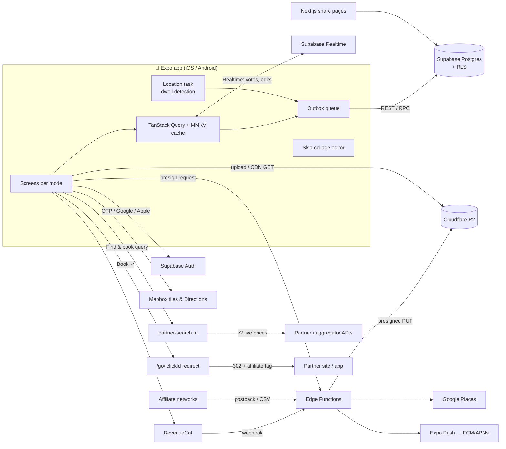
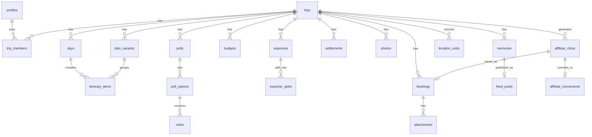

# 03 · Architecture & Tech Stack — TravelOG

## 1. Recommendation

**Expo (React Native) + TypeScript** on the client, **Supabase** (Postgres) as the backend, **Cloudflare R2** for photos, **Mapbox** for maps.

### Why Expo/React Native over Flutter

| Criterion | Expo / RN | Flutter |
|---|---|---|
| One language across app + backend functions + future web planner | ✅ TypeScript everywhere | ❌ Dart app, TS/other backend |
| Over-the-air updates (fix itinerary bugs without store review) | ✅ EAS Update | ⚠️ Shorebird (3rd party) |
| Maps with offline packs | ✅ `@rnmapbox/maps` | ✅ `mapbox_maps_flutter` |
| Custom canvas for collage editor | ✅ `react-native-skia` | ✅ native Skia/Impeller |
| Instagram/WhatsApp share intents | ✅ `react-native-share` | ✅ `share_plus` + plugins |
| Hiring pool in India | ✅ larger (React devs) | ✅ good |
| Web share pages (trip link previews) | ✅ reuse components via Expo web/Next.js | ⚠️ Flutter web is heavy for SEO pages |

Both would work; RN wins on single-language, OTA and web reuse.

### Why Supabase over Firebase
The data is **relational** (trips → days → items, polls → votes, expenses → splits, members → roles). Postgres + Row-Level Security models "only trip members can see this" directly in SQL, Realtime gives live votes/edits, and pricing is flat and predictable. Firebase/Firestore would require denormalisation and per-read billing that grows with chatty realtime screens.

## 2. Stack

| Layer | Choice | Purpose |
|---|---|---|
| App framework | Expo SDK (managed + dev client), Expo Router | iOS + Android from one codebase, file-based routes per mode |
| State / data | TanStack Query (persisted to MMKV), Zustand (UI state) | caching, offline reads, optimistic writes |
| Animation | Reanimated, Gesture Handler | drag-reorder, sheets, mode transitions |
| Maps | `@rnmapbox/maps`, Mapbox Directions, offline packs | Trip map, routes, travel times |
| Location | `expo-location` + `expo-task-manager` | opt-in background dwell detection during Live trips |
| Images | `expo-image-picker`, `expo-image-manipulator`, `expo-image` | pick, resize to 1600 px WebP/JPEG before upload, cached display |
| Collage | `@shopify/react-native-skia` | templates, stickers, export 1080×1350 / 1080×1920 |
| Sharing | `react-native-share`, Expo Linking | IG Stories intent, share sheet, WhatsApp, UPI deep links |
| Backend | Supabase: Postgres, Auth, Realtime, Edge Functions (Deno/TS), Cron | data, auth, live polls, server logic |
| Object storage | Cloudflare R2 + custom domain CDN | photos, attachments; zero egress fees |
| Places | Google Places API (New), cached server-side 7 days | Nearby, place search |
| Payments | RevenueCat over App Store / Play Billing | subscriptions + Trip Pass (consumable/non-consumable) |
| AI planner | Claude API via `ai-plan` Edge Function (Haiku 5.5 for free routes, Opus/Sonnet 5.5 for paid) | Plan with AI, Trip check, Re-plan today |
| Affiliate booking | `partner-search` Edge Function, `/go` click redirect (Cloudflare Worker), network postbacks | Find & book in the Bookings tab |
| Push | Expo Push → FCM/APNs | poll, expense, reminder notifications |
| Email | Resend | invites, receipts |
| Analytics / errors | PostHog, Sentry | product analytics, crash reporting |
| CI/CD | GitHub Actions + EAS Build/Submit/Update | builds, store submission, OTA |
| Web | Next.js on Vercel/Cloudflare Pages | trip invite/share previews, public itineraries (SEO) |

## 3. System diagram



## 4. Data model (core)



| Table | Key columns |
|---|---|
| `profiles` | id, name, avatar_url, phone, upi_id (encrypted), home_currency, plan |
| `trips` | id, owner_id, title, destination, start_date, end_date, status, base_currency, cover, visibility, pass_active |
| `trip_members` | trip_id, user_id, role (owner/editor/viewer), spending_limit, joined_at |
| `days` | id, trip_id, date, index |
| `plan_variants` | id, trip_id, day_id (nullable = whole trip), name, author_id, is_main |
| `itinerary_items` | id, day_id, variant_id, type, title, place_id, lat, lng, start_time, duration_min, est_cost, currency, sort_order, notes |
| `polls` | id, trip_id, type, question, style (single/multi/ranked), deadline, anonymous, status, locked_option_id |
| `poll_options` | id, poll_id, label, payload jsonb (place / variant_id / date range) |
| `votes` | poll_id, option_id, user_id, rank |
| `budgets` | trip_id, category, amount |
| `expenses` | id, trip_id, paid_by, amount, currency, fx_rate, category, item_id, receipt_url, spent_at |
| `expense_splits` | expense_id, user_id, share_amount |
| `settlements` | id, trip_id, from_user, to_user, amount, method (upi/cash), settled_at |
| `bookings` | id, trip_id, type, provider, ref, starts_at, ends_at, cost, covers user_ids[] |
| `attachments` / `photos` | id, trip_id, owner_id, r2_key, width, height, taken_at, lat, lng, day_id |
| `memories` | id, trip_id, author_id, template, layout_json, export_key |
| `feed_posts`, `reactions`, `comments`, `follows`, `reports` | social graph + moderation |
| `location_visits` | trip_id, user_id, item_id?, lat, lng, arrived_at, left_at |
| `affiliate_clicks` | id (= sub-id sent to partner), trip_id, user_id, partner, category, query jsonb, offer_ref, price_shown, created_at |
| `ai_usage` | user_id, trip_id, route (check/draft/fill/replan), model, input_tokens, output_tokens, cost_usd, created_at |
| `itinerary_posts` | id, trip_id, author_id, title, days jsonb, actuals jsonb, verified, visibility, fork_count, published_at |
| `forks` | post_id, new_trip_id, user_id, created_at |
| `creator_earnings` | post_id, author_id, conversion_id, amount, status |
| `affiliate_conversions` | click_id, network, partner_order_ref (hashed), status (pending/confirmed/cancelled), commission, currency, reported_at |

**RLS rule of thumb:** every trip-scoped table has `using (is_trip_member(trip_id))`; writes additionally check role. Balances are computed by a SQL view; "simplify debts" runs in an Edge Function.

## 5. Key flows

**Photo upload** — pick → resize on device (1600 px long edge, ~400–500 KB, + 320 px thumb) → request presigned URL (Edge Function checks membership + quota) → PUT to R2 → insert `photos` row. Originals stay on the phone unless the user enables "Keep originals" (Plus).

**Polls live** — clients subscribe to `votes` changes for the trip via Realtime; lock-in is a Postgres function (`lock_poll(poll_id, option_id)`) that atomically applies the result (e.g. promotes a variant) and emits a push.

**Offline (Trip mode)** — at T‑1 day the app prefetches itinerary, bookings + attachments, and a Mapbox offline pack for the trip bbox. Writes (expenses, check-ins, photos) go to an outbox and replay on reconnect with client-generated UUIDs (idempotent). If collaborative conflicts grow, migrate to PowerSync (Supabase-native sync).

**Location timeline** — background task only while a trip is Live and user opted in; on-device clustering → `location_visits` upload of visits only (no raw GPS trail).

**Instagram share** — Skia renders to a PNG at export size → `react-native-share`: `Share.shareSingle({ social: INSTAGRAM_STORIES, backgroundImage })` for Stories (needs a Facebook App ID), share sheet for Feed posts.

**Find & book (affiliate)** —
1. App sends the pre-filled query (Stays: place, dates, guests · Transport: from, to, date, travellers · Activities: area, dates) to the `partner-search` Edge Function.
2. v1: the function returns partner **deep links** (each partner's own search URL with our affiliate tag) plus cached sample prices. v2: it calls partner/aggregator APIs (for Transport: flight, train and bus partners in parallel, then merged and tagged Cheapest/Fastest), normalises results into one OfferCard shape and caches them for 24 h per (place, dates, guests).
3. **Book ↗** hits `/go/:clickId` (Edge Function or Cloudflare Worker): it inserts an `affiliate_clicks` row and 302-redirects with the click id as the network **sub-id**, so a conversion can be traced back to the trip without sending personal data to the partner.
4. Networks report conversions by postback URL or daily CSV → `affiliate_conversions` (pending → confirmed after the stay/travel date, usually 30–60 days).
5. When the user returns, the "Did you book it?" sheet creates a `bookings` row linked to the click. That gives the user their ticket wallet entry even before the network confirms.
Bookings happen on the partner's site, so no in-app purchase rules or payment handling apply.

**AI planner** —
1. Edge Function `ai-plan` (TypeScript, official Anthropic SDK, streaming) runs a tool-use loop with these tools: `search_places`, `travel_times` (Mapbox Matrix / self-hosted routing), `climate_normals` and `forecast` (Open-Meteo), `opening_hours`, `find_stays` / `find_transport` (the partner-search function), `advisories` (seasonal closures, permits, visa notes from a curated table).
2. The final answer is returned through structured outputs in the itinerary schema (days → items, stays, transport legs, budget, notes, sources) and saved as a `plan_variant` with `author = 'ai'`.
3. **Model routing** (config table, changed without an app release): Trip check and free drafts → Claude Haiku 5.5; paid drafts, Fill this day and Re-plan today → Claude Opus 5.5 or Claude Sonnet 5.5, chosen after a quality test on real trips.
4. Prompt caching on the system prompt and tool definitions; `ai_usage` table enforces per-user quotas; `stop_reason` (including refusals) is handled before reading content.
5. Open-ended requests ("plan a 10-day Japan trip") run the same loop without an existing trip, then create the Draft trip only when the user taps **Create trip**.

**Verified trips** — at trip completion a job builds an `itinerary_posts` row from the main variant plus actuals (`expenses`, `location_visits`), strips private fields, and waits for the owner to publish. **Use this plan** creates a new trip and a `forks` row; affiliate clicks from a forked trip carry the post id so `creator_earnings` can be credited when the conversion confirms.

**Settle up** — `upi://pay?pa=<payee upi>&pn=<name>&am=<amount>&cu=INR&tn=TravelOG <trip>`; user confirms "paid" afterwards (we never touch funds).

## 6. Security & compliance
- RLS on every table; service-role key only in Edge Functions.
- R2 objects private; served through signed URLs or a Worker that checks a short-lived token.
- India DPDP Act 2023: consent screens for location/contacts, data export & deletion, data stored in a region near users (Supabase Mumbai `ap-south-1`).
- App Store: Sign in with Apple, account deletion, UGC report/block, location purpose strings.

## 7. Repo layout (planned)
```
apps/mobile      Expo app (app/(home), app/trip/[id]/plan, app/trip/[id]/live)
apps/web         Next.js share pages
packages/ui      design tokens + shared components
packages/core    types, zod schemas, split algorithm, poll logic
supabase/        migrations, RLS policies, edge functions, seed
docs/, mockups/  this design phase
```
