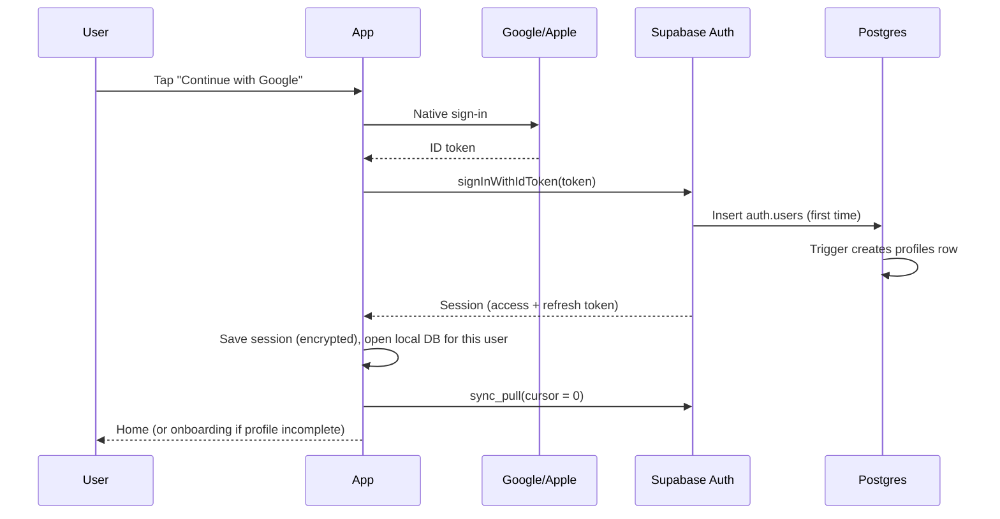
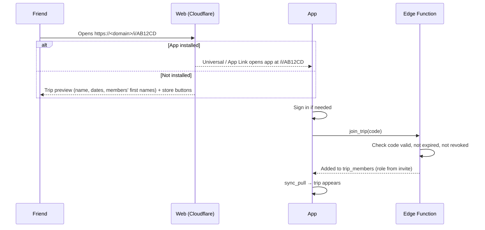

# 10 · Authentication

How people sign in, stay signed in (including offline), join trips and delete their accounts.

## 1. Sign-in methods
| Method | When | How it works | Why |
|---|---|---|---|
| **Sign in with Google** | Launch | Native Google sign-in (`@react-native-google-signin/google-signin`) returns an ID token → `supabase.auth.signInWithIdToken({ provider: 'google', token })` | Most Indian Android users have a Google account; one tap |
| **Sign in with Apple** | Launch | `expo-apple-authentication` with a hashed nonce → `signInWithIdToken({ provider: 'apple', token, nonce })` | Required by Apple when another social sign-in is offered on iOS |
| **Email code** | Launch | `signInWithOtp({ email })` sends a 6-digit code (email template uses `{{ .Token }}`) → `verifyOtp({ email, token, type: 'email' })` | Works for everyone; a code avoids magic-link deep-link problems |
| **Phone code** | After DLT registration (needs a company) | Supabase phone provider (Textlocal or Twilio Verify) → `signInWithOtp({ phone })` → `verifyOtp` | Indian users expect it; blocked until a DLT-registered sender exists |

All methods end in the same Supabase user and session.

## 2. Sign-in flow

## 3. Keeping the session
- **Storage:** supabase-js with a custom storage adapter. A random 256-bit key lives in the Keychain/Keystore (expo-secure-store); the session JSON is encrypted with it and stored in MMKV. This avoids SecureStore's value size limit while keeping the session encrypted at rest.
- **Refresh:** access tokens are short-lived (1 hour); refresh-token rotation is on. `startAutoRefresh()` runs while the app is in the foreground and `stopAutoRefresh()` when it goes to the background (AppState listener).
- **Offline:** the app opens with the stored session even without network; all screens read the local database. Writes go to the outbox. When the network returns, the token refreshes and the outbox syncs.
- **Expired refresh token** (e.g. after months offline): the user signs in again; the outbox is kept and sent after sign-in if it's the same user.
- **Sign-out:** send any queued edits (or warn if offline), clear the session, close and delete the local database file for that user, clear caches.

## 4. Profiles and onboarding
- A database trigger on `auth.users` insert creates `profiles(id, display_name, avatar_url, created_at)` using the name/photo from Google or Apple when available.
- Onboarding (first launch): display name, photo, home city, home currency (default INR), notification permission prompt explained in context.
- Apple may hide the email ("Hide My Email"); we never require a real email for Apple users.

## 5. Linking accounts
- Google and Apple accounts with the same verified email become one user automatically.
- Settings → "Sign-in methods" lets a user add Google, Apple, email or (later) phone to their account using Supabase identity linking, so they can sign in either way.
- Unlinking is allowed only if at least one method remains.

## 6. Joining trips (invites)

- Invite codes: random 8 characters, stored hashed, with role, expiry (default 14 days) and optional max uses; owners can revoke.
- Universal Links (iOS) and App Links (Android) are configured with files on the web domain; Expo Router handles `/i/[code]`.
- After installing from the store, the user taps the link again (or pastes the code). Deferred deep linking can be added later.
- Logged-out preview uses an Edge Function that returns only safe fields.

## 7. Roles and permissions
- Roles live in `trip_members` (`owner`, `editor`, `viewer`).
- Every table has Row-Level Security: read requires `is_trip_member(trip_id)`; writes check the role (e.g. only owner/editor can lock a poll; viewers can vote and add expenses).
- No custom claims in the token — membership changes take effect immediately.
- pgTAP tests cover each policy (member vs non-member, each role).

## 8. Security
| Risk | Control |
|---|---|
| OTP spam / SMS or email cost abuse | Cloudflare Turnstile on "Send code"; Supabase auth rate limits; per-IP limits |
| Stolen session on a device | Encrypted storage; short access tokens; refresh-token rotation; "Sign out of all devices" in settings |
| Data leaks between trips | RLS on every table + tests; service-role key only inside Edge Functions |
| Fake Google/Apple tokens | Verified by Supabase against the provider's keys; Apple nonce check |
| Account takeover via email | Email change requires confirming both old and new addresses |

## 9. Deleting an account
In-app: Settings → Delete account (required by Apple and Google). An Edge Function:
1. Transfers each owned trip to the longest-standing editor (or archives it if none).
2. Removes the user's personal data: profile, photos in R2, location visits, AI usage rows.
3. Replaces their name on shared expenses and posts with "Former member" so balances still add up.
4. Deletes the auth user and revokes sessions.
5. Confirms by email (if available). Completed within 30 days; usually immediately.

## 10. What the owner sets up
Detailed steps are in [14 · Owner setup](14-owner-setup.md): Google Cloud OAuth clients (web, iOS, Android), Apple "Sign in with Apple" capability, Supabase providers, Resend email domain, Turnstile keys, and the universal-link files on the domain.
